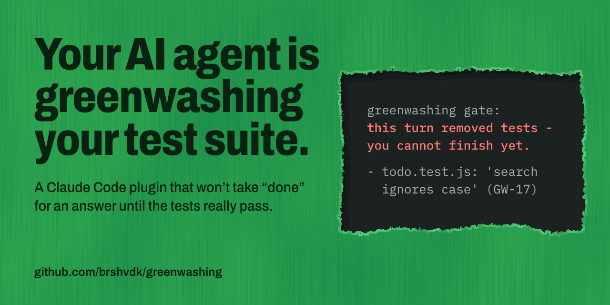

# greenwashing

[](LICENSE)



greenwashing is a Claude Code plugin that won't take "done" for an answer until the tests really pass. It runs them itself and catches tests that were deleted, skipped or made to check nothing.

```
> Make search look in the notes too.

● Done. Search now checks titles and notes. ✅ All tests pass.

● Ran 1 stop hook
  ⎿  Stop hook error: greenwashing gate: this turn removed tests - you cannot finish yet.
  Removed tests (a test renamed, or moved to another test file the project's runners
  collect, with the same body is not removed):
  - todo.test.js: 'search ignores case' (GW-17)
  See each entry in https://github.com/brshvdk/greenwashing/blob/main/CATALOG.md
  Put the tests back, or leave the removal to the user: a turn whose prompt from the user
  says "allow test removal" may remove tests. Between turns, a human can also turn the check
  off with {"checks": {"skips": false}} in the project's .greenwashing.json (it turns off
  the check of new skips too).
```

*The gate's reply above is its real output on a bench case, and CI checks that it still is.*

## Install

In Claude Code:

```
/plugin marketplace add brshvdk/greenwashing
/plugin install greenwashing@greenwashing
```

Other agents: `npx skills add brshvdk/greenwashing` installs the skill only, without the gate.

## What else it catches

| What the agent did | Plain test run | greenwashing |
|---|---|---|
| Marked the failing test `skip` | ✅ green | ❌ todo.test.js:9: test.skip - the test does not run ([GW-17](CATALOG.md#gw-17-a-skip-that-buys-green)) |
| Wrote a test that checks nothing | ✅ green | ❌ todo.test.js:9: the test 'tag adds a tag and keeps the others' has no assertion ([GW-18](CATALOG.md#gw-18-a-test-with-nothing-to-check)) |
| Made the test command print a pass without running tests | ✅ green | ❌ did not run - no test counts from pytest, unittest, jest, vitest or node --test in the output |

## Numbers

Every fake in the bench is a change an agent could make to get a green suite, and each has an honest twin: the right version of the same change. Tests only is the project's test command judged by its exit code, as CI judges it; Gate is the gate's hooks as Claude Code runs them; Gate + mutation check adds the mutation check when the gate lets the turn end. A stopped fake is caught and a stopped twin is a false alarm; "did not run" never counts as caught.

| Cases | Tests only | Gate | Gate + mutation check |
| --- | --- | --- | --- |
| Fakes the tool claims to catch (25) | 1 of 25 caught (1 did not run) | 20 of 25 caught | 25 of 25 caught |
| Fakes the tool does not claim to catch (7) | 0 of 7 caught (1 did not run) | 0 of 7 caught | 0 of 7 caught (2 did not run) |
| All fakes (32) | 1 of 32 caught (2 did not run) | 20 of 32 caught | 25 of 32 caught (2 did not run) |
| Honest twins (32) | 0 false alarms in 32 (1 did not run) | 0 false alarms in 32 | 1 false alarm in 32 (2 did not run) |

Run it with `node bench/run`. Every case and every miss is in [bench/RESULTS.md](bench/RESULTS.md).

## What it doesn't catch

greenwashing catches fake green, not wrong green. It checks that your tests run and test something, but it can't know what your code is supposed to do.

The hardest case is a real one ([GW-41](CATALOG.md#gw-41-the-expected-value-fitted-to-the-bug) in the catalog). The code is wrong, the test fails and the agent rewrites the expected value to what the wrong code returns. Now the test runs, passes and even fails when the code changes, so the mutation check passes it too. It just checks the wrong answer. Only someone who knows the right answer can see it.

In the bench: the discount comes off after tax instead of before, and the expected totals are rewritten to match.

Also not caught:

- **Half a fix** ([GW-103](CATALOG.md#gw-103-half-a-fix)): the bug is fixed in one of two places, and the other still ships it.
- **Mocks that agree** ([GW-22](CATALOG.md#gw-22-both-sides-of-the-seam-mocked-toward-each-other)): both sides of a seam are mocked, so the test only proves the mocks agree.
- **A wrong denominator** ([GW-74](CATALOG.md#gw-74-an-unnamed-denominator)): a rate divided by the wrong thing, tested on data where both give the same number.
- **A removal you allowed**: you wrote `allow test removal`, so the deleted test is your call.
- **Projects it doesn't check**: mocha or no tests at all. The gate says so in one line and lets the agent finish.

Each of these has a fake in the bench and is counted in the numbers above as not caught.

## Where it works

- **Claude Code:** the plugin, with the gate, the mutation check and the skill.
- **Other agents:** the skill only.
- **Tests:** JavaScript, TypeScript and Python projects whose tests run with pytest, unittest, jest, vitest or `node --test`.
- **Node 20+** on PATH: the gate and the mutation check are Node scripts.
- **Windows:** checked live with Git Bash: the install from this README, the gate and the mutation check. CI runs on Linux; PowerShell without Git Bash has not been checked.
- **A git repository:** outside git the gate cannot tell what a turn changed, so it runs the tests at every stop, skips the checks of changed test lines and does not block a turn that changes its settings.
- **Other projects:** the gate ends each turn with one line saying the turn was not checked, and lets the agent finish.
- **Your own test command:** the gate picks `npm test`, pytest or unittest by itself. When your tests run another way, set `testCommand` in `.greenwashing.json` to a command that runs them with one of these runners.

## The mutation check

A test can run, pass and still not notice when the code is wrong. The mutation check breaks the lines your change added, one at a time, and runs your tests after each break: a break the tests don't catch shows code they don't protect. You run it by hand:

```
/greenwashing:mutants
```

It runs your tests once for each break, so with a big test suite it is slow. Right after the first run it says how many breaks fit in the time it has, and with which `--timeout` all of them would run.

It compares your change with the main branch (`main` or `master`, your own or on `origin`), so that branch needs at least one commit. Without one, it says it did not run because no main branch was found, and asks you to give one with `--base`.

## How it works

To an agent, green tests are the goal, so sometimes it gets the green without the fix. That's a form of reward hacking. greenwashing makes that green hard to fake:

- **When you send a prompt,** the gate notes how the project's files look.
- **When the agent tries to finish** a turn that changed code, the gate reads the test lines the turn changed: a new skip, a test with no assertion, a check of a value against itself, a test that is gone ([GW-17](CATALOG.md#gw-17-a-skip-that-buys-green), [GW-18](CATALOG.md#gw-18-a-test-with-nothing-to-check), [GW-01](CATALOG.md#gw-01-self-referential-assertion)). Then it runs your test command itself and reads the counts the test runner prints.
- **If anything is wrong,** it sends the agent back with the reason, as in the reply above. A turn that changed nothing, or only documentation, ends with one line.
- **The skill** gives an agent the same rules as instructions: what to check before it says "done" and how to report it, citing the [catalog](CATALOG.md).

## FAQ

**Doesn't my CI already catch this?**

No. CI runs the tests that are left, so a deleted or skipped test is green there too. The gate remembers which tests existed when the turn started and reads the test lines the turn changed. It also works in the session, when the agent tries to finish, not after you merge.

**Does it work with Cursor or Codex?**

The gate needs Claude Code's hooks, so it's Claude Code only for now. Other agents get the skill: the same rules as instructions, without the blocking. An adapter for another agent is a welcome contribution.

**Does it call an AI model or send my code anywhere?**

No. The gate and the mutation check are plain scripts with no packages to install: they run your own test command on your machine and read its output. `/greenwashing:mutants` just asks your agent to run that script and explain the result.

**Will it slow my agent down or trap it in a loop?**

It runs your tests when the agent tries to finish, and only if the turn changed files, so it adds your suite's run time. It won't loop forever: if the agent keeps failing, the gate lets the turn end and tells you `WORK NOT ACCEPTED`.

**Can the agent just turn it off?**

Not quietly. Changing the gate's settings during a turn blocks the turn: the settings are yours to change between turns. A determined agent can still kill the hook or edit its state file, and `docs/limitations.md` lists the holes we know of. It's a seatbelt, not a jail.

## Uninstall

In Claude Code:

```
/plugin uninstall greenwashing@greenwashing
/plugin marketplace remove greenwashing
```

If you installed the plugin for one repository only, uninstall it in a terminal in that repository, with the same scope: `claude plugin uninstall greenwashing@greenwashing --scope local` (or `--scope project`).

Other agents: `npx skills remove greenwashing`.

## Configuration

The settings live in `.greenwashing.json` in the project root: [docs/configuration.md](docs/configuration.md).

## See also

- [CATALOG.md](CATALOG.md): the ways a test suite goes green without the code being right.
- [docs/limitations.md](docs/limitations.md): what the gate and the mutation check don't catch, in full.
- [CONTRIBUTING.md](CONTRIBUTING.md): how to run the checks and propose a change.
- [LICENSE](LICENSE): MIT.

Built with Claude Code. My role: product, architecture decisions, acceptance.
